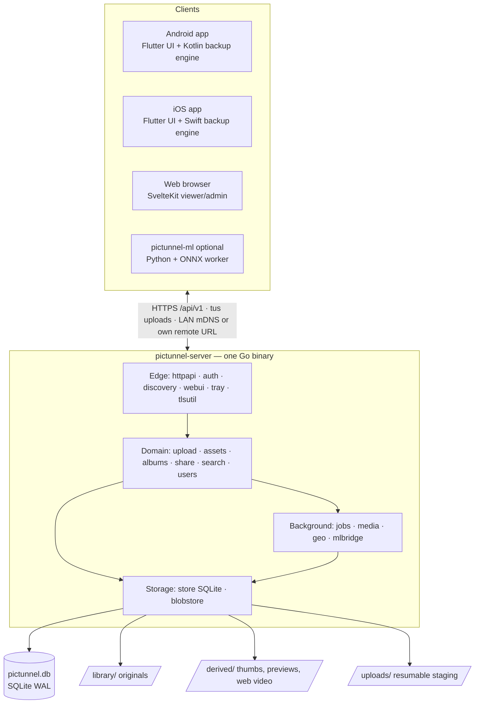
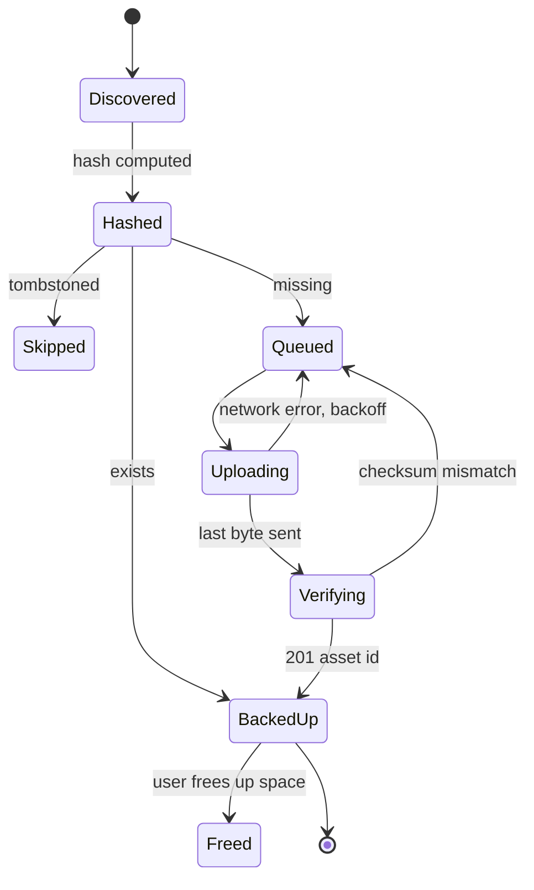
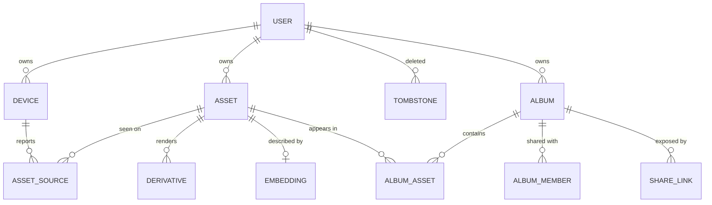

# PicTunnel — System Design

- **Status:** Approved (2026-10-03)
- **Visual version:** https://claude.ai/artifact/Bm2KvXNJjRzC4PkpX49tRu
- **Input research:** [`deep-research-report.md`](../../../deep-research-report.md)

This document is the umbrella design for PicTunnel. Each sub-project in §11 gets its own detailed spec and implementation plan; those specs refine this document and must not contradict it without updating it.

---

## 1. Product intent

PicTunnel is a **public open-source**, self-hosted photo and video backup. It installs like a desktop app (or one `docker run` on a NAS), backs phones up reliably in the background, lets users browse and download their library from phone and web, and **never stores the same photo twice** for a user.

It targets the gaps found in the research: setup friction (Docker/tinkering), background upload that stops when the phone sleeps, weak resume after disconnects, and lock-in.

### Goals
1. Install in under 5 minutes: no Docker on desktop; one `docker run` on NAS.
2. Pair a phone with one QR scan.
3. Background backup that survives sleep, app kills, reboots and flaky Wi‑Fi.
4. Exactly one stored copy per (user, content). Retries, reinstalls and second phones never create copies.
5. Fast timeline browsing on phone and web; download originals anywhere.

### Non-goals for v1.0
Own relay/tunnel service · two-way sync of deletes/edits · end-to-end encryption · photo editing / RAW development · desktop folder-sync clients · cloud storage tiers.

### Success criteria

| Criterion | Target | Measured by |
|---|---|---|
| Zero duplicates | 0 duplicate assets after chaos suite (10k files, random kills, two devices) | CI invariant check |
| Zero loss | Every file marked "backed up" on the phone exists on the server with matching hash | CI invariant check |
| Resume cost | Interrupted upload re-sends ≤ 1 chunk (8 MiB default; 64 MiB on iOS background) | Chaos suite byte counters |
| LAN throughput | ≥ 70 MB/s on gigabit Ethernet to SSD | Bench tool |
| Initial backup | 10,000 photos (~40 GB) finish overnight on Wi‑Fi without opening the app | Device test matrix |
| Timeline | 60 fps scroll on 100k-asset library, mid-range phone | Perf overlay + seed library |
| Footprint | Idle server < 150 MB RAM; Docker image < 120 MB incl. ffmpeg | Release checklist |

## 2. Locked decisions

| Area | Decision |
|---|---|
| Audience | Public OSS product; easy install and polish are first-class |
| Name | PicTunnel (trademark/store/domain checks before first public release) |
| License | Split: `server/`, `web/`, `ml/` AGPL-3.0; `mobile/`, `api/` (spec + SDKs) Apache-2.0. DCO sign-off, no CLA |
| Server form | One Go binary; desktop tray build (Win/macOS/Linux) and Docker image (amd64/arm64) |
| Mobile | Flutter UI; full backup pipeline native (Kotlin + Swift) via Pigeon |
| Network | LAN with mDNS discovery + optional user-supplied remote URL (reverse proxy, Tailscale, Cloudflare Tunnel) |
| Sync model | One-way backup; server Trash (30 days); tombstones block re-upload; opt-in "free up space" |
| Identity & dedup | SHA-256 of original bytes; `UNIQUE(owner_id, sha256)` |
| Upload protocol | tus 1.0 + creation, creation-with-upload, checksum, termination, expiration |
| Library on disk | Human-readable folders `library/<user>/YYYY/MM/<file>`, path fixed at ingest |
| Web viewer | SvelteKit static build embedded in the server binary |
| ML | Optional Python + ONNX Runtime worker; core never depends on it |
| v1.0 scope | Backup, browse, download, multi-user, web viewer, albums + share links, metadata search + AI tagging. No scope cuts |
| Team | Solo developer, full speed; plans structured for parallel agent execution |
| Apple | No Apple account, Mac or iPhone for now; iOS built/tested in CI; decision point at v0.9 |

## 3. Architecture



**Module rule:** modules call each other only through Go interfaces and never read each other's tables.

**One binary:** SQLite via pure-Go `modernc.org/sqlite` (no cgo → trivial cross-compile). Static ffmpeg/ffprobe ship alongside. `pictunnel --tray` (desktop) and `pictunnel serve` (Docker) run identical code.

## 4. Sync and backup protocol (summary)

Full normative detail lives in the sub-project 1 spec (`2026-10-03-contract-and-sync-protocol-design.md`).

**Three rules**
1. **Content is identity** — SHA-256 of original bytes; `UNIQUE(owner_id, sha256)`.
2. **Server is the source of truth** — phone state is a rebuildable cache.
3. **Commit once, at the end** — staging → verify hash → fsync → atomic rename → single DB transaction.

**Phone pipeline:** Scan (incremental via `PHPersistentChangeToken` / `MediaStore.getGeneration()`) → Hash (platform crypto, cached by `(local_id, modified, size)`) → Check (`POST /api/v1/sync/check`, ≤1000 hashes; verdicts `exists` / `missing` / `partial` / `tombstoned`) → Upload (tus) → Confirm (`asset_id`).



**Idempotency guarantees:** retried creates return the same upload; killed apps resume from server offset; committed-but-unacknowledged uploads are recognized by the next check; concurrent uploads of the same content from two devices resolve to one asset; reinstall re-hashes and uploads nothing; corrupted bytes are rejected before commit; deliberately deleted content is tombstoned; albums reference, never copy.

**Edits, Live Photos, bursts:** an edited photo is its own asset (different bytes) stacked with the original; Live/motion photos are one asset with a paired video component; bursts stack under a cover.

**Browsing:** delta change feed `GET /api/v1/sync/changes?cursor=` (410 → full snapshot resync); thumbnails on demand with LRU cache; timeline merges local + server by hash; downloads to phone skip content already in the gallery.

## 5. Data model and storage



| Table | Purpose | Key constraint |
|---|---|---|
| `assets` | One row per unique original per user | `UNIQUE(owner_id, sha256)` |
| `asset_sources` | Device + local id → asset | `UNIQUE(device_id, local_id)` |
| `tombstones` | Deliberately deleted content | `PK(owner_id, sha256)` |
| `upload_sessions` | In-progress tus uploads (24 h expiry) | `UNIQUE(owner_id, sha256)` while active |
| `change_log` | Monotonic change sequence for delta sync | `seq INTEGER PRIMARY KEY` |
| `jobs` | Durable background work | `UNIQUE(kind, dedupe_key)` |
| `users`, `devices`, `refresh_tokens` | Accounts and credentials (hashed) | token hash unique |
| `albums`, `album_assets`, `album_members`, `share_links` | Organization and sharing | share token stored hashed |
| `assets_fts`, `embeddings`, `faces` | Search indexes and ML outputs | — |
| `audit_log` | Security and backup events | append-only |

IDs are UUIDv7. Timestamps UTC + original offset.

```
<data-dir>/                 # SSD; configurable
├── config.toml
├── pictunnel.db (+wal,shm)
├── tls/                    # self-signed CA + cert, first run
├── uploads/                # tus staging, 24 h expiry
├── derived/ab/cd/<asset-id>/{thumb.jpg,preview.jpg,web.mp4}
└── backups/                # nightly SQLite online backups, keep 7
<library-dir>/<user>/YYYY/MM/IMG_0042.HEIC   # may be a NAS volume
```

Library rules: path decided once at ingest, never moved; collisions checked case-insensitively after NFC normalization → `~2` suffix; library documented as read-only from outside; weekly `fsck_library` reports drift; `import_library` rebuilds the catalog from folders.

## 6. Server internals

| Concern | Choice |
|---|---|
| HTTP | stdlib `net/http` routing; `oapi-codegen` strict server |
| DB | SQLite WAL via `modernc.org/sqlite`; one writer, reader pool |
| Queries/migrations | `sqlc`; `goose` migrations embedded; auto-backup before migrating |
| Uploads | `tusd` v2 as a library behind our auth, finalize hook into `assets` |
| Jobs | Table-backed queue: leases, exp. backoff + jitter, max attempts, dead-letter, idempotent enqueue via `dedupe_key` |
| Metadata | `imagemeta` (pure Go) + `ffprobe` |
| Thumbnails | Go pipeline for JPEG/PNG; ffmpeg for HEIC/AVIF/video; embedded preview for RAW |
| Video | Transcode to H.264 MP4 only when not browser-playable |
| Places | Embedded GeoNames cities dataset, offline reverse geocoding |
| Config | TOML + `PICTUNNEL_*` env + flags |
| Observability | `slog` JSON, `/healthz`, `/readyz`, optional `/metrics`, admin dashboard |

Job kinds: `extract_metadata`, `generate_thumbnails`, `transcode_video`, `reverse_geocode`, `ml_embed`*, `ml_faces`*, `purge_trash`, `expire_uploads`, `fsck_library`, `backup_database`, `import_library`, `compact_change_log` (*optional). Every job is safe to run twice (temp output → rename → upsert).

## 7. Mobile app

- **Flutter (Dart):** screens (onboarding/pairing, timeline, viewer, albums, search, backup status, settings), Riverpod state, `drift` metadata mirror, generated Dart API client, thumbnail cache.
- **Bridge:** Pigeon `BackupEngineApi`, `MediaLibraryApi`, event stream.
- **Android engine (Kotlin):** MediaStore scanner, WorkManager workers with content-URI trigger, tus-java-client + OkHttp, Room queue DB; foreground service `dataSync` / user-initiated data transfer jobs (Android 14+).
- **iOS engine (Swift):** PhotoKit scanner, `BGTaskScheduler` (`BGAppRefreshTask`, `BGProcessingTask`, `BGContinuedProcessingTask` on iOS 26), background `URLSession` upload tasks from files, SQLite queue DB.
- **Settings:** Wi‑Fi only / cellular, charging only, low-battery pause, album selection, include videos.
- **Free up space:** `MediaStore.createDeleteRequest` / `PHAssetChangeRequest.deleteAssets` (system confirmation), only for items the server confirms present.
- Endpoints tried in order: LAN (mDNS) then remote URL. Credentials in Keychain / Keystore.

## 8. Web viewer

SvelteKit static adapter → `server/internal/webui/dist` via `go:embed`; generated TS client. Virtualized justified timeline with date scrubber; viewer (zoom, Live Photo, video); Range downloads and streamed ZIP; tus-js-client drag-and-drop upload; admin (setup, users, quotas, devices, pairing QR, storage, jobs, settings); public share page `/s/<token>`.

## 9. Security

- HTTPS always; self-generated CA/cert pinned during pairing; public certs validated normally behind a proxy; plain HTTP only on `localhost` for first-run.
- mDNS `_pictunnel._tcp` (server id + version, no secrets).
- Argon2id passwords; rate-limited login with short lockout.
- 15-min access tokens; rotating device-bound refresh tokens stored hashed; refresh reuse revokes the device.
- Web: HttpOnly/Secure/SameSite=Lax cookies + CSRF token.
- Authorization in the repository layer (owner or album membership); cross-user access tests on every endpoint.
- Share links: 128-bit tokens stored hashed, expiry, optional password, download toggle, revocation, access logging.
- Dedup check is per-user (no cross-user existence oracle).
- Supply chain: cosign-signed releases, SBOMs, pinned deps, CodeQL, `govulncheck`, `SECURITY.md`.

## 10. Albums, sharing, search, AI

Albums reference assets; shared albums have `viewer` / `contributor` roles; ownership stays with uploader. Share links for albums/selections. Metadata search via FTS5 + indexed columns (date, place, camera, type, favorites, filename, album). Optional ML worker pulls leased jobs (`/internal/ml/jobs`), produces CLIP-style embeddings (int8, brute-force cosine in Go) and faces → People. **Only permissively licensed models** (e.g. OpenCV Zoo YuNet/SFace; OpenCLIP/MobileCLIP after license review); models downloaded on first start.

## 11. Sub-projects and build order

| # | Sub-project | Delivers | Depends on |
|---|---|---|---|
| 1 | Contract & protocol (+ repo foundation) | OpenAPI, sync protocol doc, test vectors, ADRs, monorepo + CI + codegen | — |
| 2 | Server core | Auth, pairing, uploads, dedup, library, jobs, thumbnails, metadata, change feed | 1 |
| 3 | Mobile app + engines | Native engines (Android, then iOS), timeline, viewer, download | 1, 2 |
| 4 | Web viewer | Timeline, viewer, download, upload, admin | 1, 2 |
| 5 | Albums, sharing, search | Albums, shared albums, links, metadata search | 2, 3, 4 |
| 6 | ML worker | Semantic search, faces | 2, 5 |
| 7 | Packaging & release | Installers, Docker, stores, docs site, update checks | all |

## 12. Failure modes

| Failure | Behavior |
|---|---|
| Wi‑Fi drops mid-upload | Backoff + jitter; resume from `HEAD` offset |
| App killed / reboot | Re-check in-flight hashes, then resume or mark done |
| Server crash mid-write | Staging resumable for 24 h; finalize journal recovers; no catalog row before commit |
| Disk full | `507` before accepting; phone pauses + notifies; admin warning |
| Over quota | `413` with quota code |
| Hash mismatch | Reject, discard staging; client retries ×3 then "needs attention" |
| Overload | `429`/`503` + `Retry-After` |
| External library edits | Weekly fsck report; never auto-delete |
| DB corruption | `integrity_check` on start; restore from nightly backup or rebuild from library |
| Version skew | `/api/v1/server/info` capabilities; 1.x compatible; min client version |
| Missing photo date | File times fallback, flagged uncertain |

Client retry rule: retry network errors and `5xx`; not `4xx` except `408`, `409`, `423`, `429`.

## 13. Testing strategy

Protocol conformance vectors (Go, Kotlin, Swift) · Go chaos client (cut connections at random offsets, duplicate/reorder requests, multi-device) asserting zero-duplicate and zero-loss · server unit/integration with real SQLite + `httptest` + `rapid` property tests · fault injection (FS interface, Toxiproxy) · Android JUnit/Robolectric/WorkManager test helpers · iOS XCTest on CI macOS runners · Flutter widget/golden + Patrol E2E · Web Vitest + Playwright · 100k seed-library performance tests · real-device matrix (3 Android OEMs; iOS via community testers).

## 14. Repository layout

```
pictunnel/
├── README.md  CONTRIBUTING.md (DCO)  SECURITY.md  CODE_OF_CONDUCT.md
├── LICENSE                 # AGPL-3.0 (server/, web/, ml/)
├── Taskfile.yml            # task gen | test | dev | release
├── .github/workflows/      # ci-api, ci-server, ci-mobile, ci-web, ci-ml, release, codeql
├── api/                    # LICENSE Apache-2.0
│   ├── openapi.yaml
│   └── protocol/{sync-protocol.md, vectors/}
├── server/                 # Go: cmd/pictunnel, internal/{app,config,httpapi,auth,upload,assets,
│                           #   blobstore,media,jobs,albums,share,search,geo,mlbridge,discovery,
│                           #   tlsutil,tray,webui,store}, test/
├── mobile/                 # LICENSE Apache-2.0; Flutter lib/{app,core,features}, pigeons/,
│                           #   android/.../backup/, ios/Runner/Backup/
├── web/                    # SvelteKit src/{routes,lib}
├── ml/                     # Python worker
├── packaging/              # docker/, windows/, macos/, linux/, ffmpeg/
├── docs/                   # user docs, adr/, superpowers/{specs,plans}
└── tools/                  # seed-library, chaos-client, bench
```

## 15. Release plan

Durations assume one full-time developer with AI assistance.

| Milestone | Duration | Content | Exit criterion |
|---|---|---|---|
| M0 Foundations | 2 wk | Monorepo, CI, OpenAPI v0, protocol doc + vectors, ADRs, license docs | Generated clients compile in CI from the spec |
| v0.1 alpha | 6 wk | Server core (single admin), pairing, tus, dedup, library, jobs, thumbs, metadata; Android engine; basic timeline/viewer; binaries + Docker + APK | Chaos suite passes; 10k photos overnight on a real phone |
| v0.2 alpha | 6 wk | iOS engine (CI-tested), delta sync + offline mirror, download without duplicates, Trash + tombstones, read-only web viewer | Both engines pass the same vectors |
| v0.3 beta | 4 wk | Multi-user, quotas, devices, albums, shared albums, web upload | Cross-user access tests cover every endpoint |
| v0.4 beta | 4 wk | Share links, FTS5 search, offline places, free up space, ZIP downloads | Search < 200 ms on 100k seed |
| v0.5 beta | 3 wk | Tray app, MSI/DMG/deb/rpm/AppImage, first-run wizard, update check, NAS guides | Non-technical tester installs + pairs < 5 min |
| v0.6 beta | 5 wk | ML worker, semantic search, People, model license review | Core works with worker stopped; 10k photos indexed < 1 h on CPU |
| v0.9 RC | 3 wk | Security review, perf, device matrix, docs site, upgrade tests | No open P0/P1 for 2 weeks |
| v1.0 GA | ~Jun 2027 | Play, F-Droid, signed installers, multi-arch Docker, API v1 frozen for 1.x | — |

### Risk register

| Risk | Mitigation | Decision point |
|---|---|---|
| No Mac / iPhone / Apple account | CI macOS builds + simulator tests; shared vectors; recruit community iOS testers | v0.9: buy account + device tests, or ship iOS as "beta, community-tested" |
| Unsigned macOS app | Document Gatekeeper steps; Homebrew cask; Docker | v0.9 |
| Android OEM battery killers | Per-OEM guide, foreground-service fallback, "last backup" warning | v0.1 device matrix |
| Solo bus factor | Specs/ADRs/plans in repo; early public alphas | ongoing |
| ML model licensing | Permissive-license allowlist | v0.6 |

### Release engineering
GoReleaser (archives, checksums, SBOM, cosign) · GHCR multi-arch images (`stable`, `beta`, version tags) · Windows MSI (WiX; SignPath OSS signing) · macOS DMG (unsigned until Apple account) · Linux deb/rpm (nfpm) + AppImage · Android Play ($25 once), F-Droid (no proprietary SDKs), GitHub APK · iOS TestFlight/App Store gated on Apple account · SemVer, API versioned separately (`/api/v1`) · no telemetry by default.

## 16. After 1.0
Built-in relay/tunnel · opt-in E2EE · on-device ML · family spaces · storage tiers and 3-2-1 backups · Takeout/iCloud import, desktop folder watcher, webhooks/plugins.
