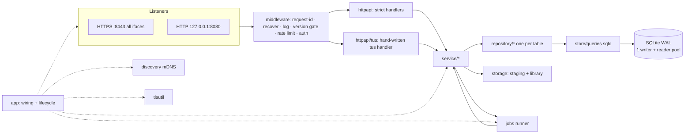
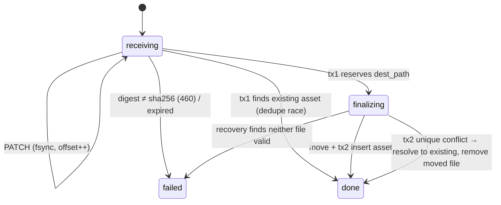

# PicTunnel — Sub-project 2A: Server Sync Core

- Status: Draft for review · Date: 2026-10-12
- Parent: [System design](2026-10-03-pictunnel-system-design.md) §11, sub-project 2 (split into 2A sync core, 2B media pipeline)
- Contract: [`api/openapi.yaml`](../../../api/openapi.yaml), [`api/protocol/sync-protocol.md`](../../../api/protocol/sync-protocol.md) (normative; this spec implements it and does not restate it)

## 1. Intent and scope

**Goal.** `pictunnel serve` becomes a real, crash-safe backup server: a phone (or any tus client) can pair, upload, resume, dedupe, browse, download, trash and purge, with every guarantee in sync-protocol §5–§7 holding under drops, retries, concurrent devices and process crashes.

**In scope (2A).**
- All 30 contract operations (including `/healthz` and `/readyz`).
- SQLite store with migrations, a durable job queue, and the 2A jobs (§9).
- Our own tus 1.0 handler, the finalize journal and startup recovery.
- Library path assignment.
- Auth: password, tokens, web cookie sessions, pairing.
- Self-signed TLS with a stable SPKI pin.
- mDNS discovery.
- Config, logging, rate limits, version gate.

**Deferred to 2B (media pipeline).** These stay as stubs in 2A:

| Concern | 2A behavior | 2B replaces with |
|---|---|---|
| Embedded date read at finalize (§7.5) | `DateProbe` returns "unknown". The path date falls back to client `created_at`, then receive time. | EXIF / container probe |
| `extract_metadata`, `generate_thumbnails` jobs | Enqueued by finalize (normative), but no handler is registered, so they stay `pending` | Handlers |
| `GET …/thumbnail` | `404 not_ready` | JPEG derivatives |
| `GET …/playback` | Original with `Range` for `video/mp4` and `video/webm`. Other videos return `404 not_ready`; photos return `404 not_found`. | Transcode decision |
| `width`, `height`, `lat`, `lon`, `duration_ms` | `null` | Real values |

**Out of scope.** Web UI embedding, tray app, albums, search, ML, `fsck_library`, `import_library`.

**Exit criteria.** All of these must hold, and all run in CI:
1. All 17 server-scenario vectors pass in the in-process runner. Every response the runner sees also validates against `openapi.yaml`.
2. The crash matrix (§11.4) passes for every finalize and append failpoint: no duplicate asset, no lost bytes, no orphan file, no stuck session.
3. Property and chaos tests (§11.5) hold their invariants over at least 500 random runs per CI build.
4. A tus-js-client interop smoke test uploads, drops and resumes against the real binary over HTTPS with the pinned certificate.
5. `go test -race` is green on Linux, Windows and macOS; `golangci-lint` is clean; the cross-compile matrix is green; sqlc/codegen drift checks pass.
6. Coverage is ≥ 85 % for `service/`, `repository/` and `httpapi/`, enforced in CI.

## 2. Architecture

### 2.1 Package layout (`server/internal/`)

| Package | Role | May import |
|---|---|---|
| `app` | Wiring (config → store → repos → services → http → jobs → discovery), start/stop, boot sequence (§10.1) | everything |
| `config` | TOML file + `PICTUNNEL_*` env + flags → typed `Config` with defaults and validation | stdlib |
| `clock` | `Clock` interface (`Now()`); `Real`; `Fake` with `Advance` (test use only, lives in `clock/clocktest`) | stdlib |
| `store` | Opens SQLite (writer + reader pool), `WithTx(ctx, fn)`, embedded goose migrations, integrity check, online backup | `store/queries` |
| `store/queries` | sqlc output (generated, committed, drift-checked) | — |
| `repository` | One type per table, pure CRUD on that table only (§3) | `store`, `store/queries`, `apperr` |
| `service` | Orchestration and policy. Constructors take exactly the repositories they use. | `repository`, `storage`, `jobs`, `clock`, `apperr`, `contenthash` |
| `storage` | Filesystem port: staging files, library moves (fsync/rename/copy), free-space query, path sanitization. Has an `FS` interface so tests can inject faults. | stdlib |
| `jobs` | Durable queue runner: leases, backoff, dead-letter, periodic scheduling; handlers registered by `app` | `repository`, `clock` |
| `apperr` | Every domain error, one file per flow (`auth.go`, `pairing.go`, `upload.go`, `sync.go`, `assets.go`, `request.go`); each carries its problem code | stdlib |
| `httpapi` | Strict-server implementation of the generated interface, problem+json writer, middleware, auth extraction | `service`, `apperr`, `httpapi/gen` |
| `httpapi/tus` | Hand-written tus handler mounted on `/api/v1/uploads` | `service`, `apperr` |
| `tlsutil` | CA and leaf generation, renewal, SPKI fingerprint | stdlib, `x/crypto` |
| `discovery` | mDNS responder for `_pictunnel._tcp` | `config` |
| `contenthash` | (exists) generic streaming SHA-256 | stdlib |
| `conformance` | (exists) vector loader, plus the scenario runner (test-only package, §11.2) | `app`, `clock/clocktest` |

Rules (enforced by a `depguard` lint config):
- `repository` never imports `service`.
- `contenthash`, `tlsutil` and `storage` import no domain package.
- Handlers contain no business logic; they map request → service call → response or `apperr`.

This table replaces the server package list in the system design §14.

### 2.2 The tus split

`StrictServerInterface` requires all 30 operations. The five upload operations (`optionsUploads`, `createUpload`, `getUploadOffset`, `appendUpload`, `terminateUpload`) are routed to `httpapi/tus` before the strict router. tus needs raw streaming bodies and exact header control that the strict wrapper hides. Their strict-interface methods exist only to satisfy the interface and return `internal` if ever reached. A test asserts that they are unreachable.

## 3. Data model

One goose migration, `0001_init.sql`, creates every table. Later migrations are append-only. IDs are UUIDv7 text. Times are stored as RFC 3339 UTC text with millisecond precision. Booleans are `INTEGER 0/1`. `PRAGMA foreign_keys=ON`, `journal_mode=WAL`, `synchronous=FULL` on the writer, `busy_timeout=5000`.

| Table | Columns (abridged) | Keys and indexes | Repository |
|---|---|---|---|
| `server_state` | `key`, `value` | PK `key`. Rows: `server_id`, `change_log_floor`, `setup_token_hash` | `ServerStateRepository` |
| `users` | `id`, `username`, `slug`, `display_name`, `role`, `password_hash`, `quota_bytes` NULL, `created_at`, `disabled_at` NULL | UNIQUE `username COLLATE NOCASE`; UNIQUE `slug` | `UsersRepository` |
| `devices` | `id`, `user_id`, `name`, `platform`, `app_version`, `created_at`, `last_seen_at`, `revoked_at` | idx `user_id` | `DevicesRepository` |
| `access_tokens` | `token_hash`, `device_id`, `expires_at` | PK `token_hash`; idx `device_id`, `expires_at` | `AccessTokensRepository` |
| `refresh_tokens` | `token_hash`, `device_id`, `family_id`, `state` (`active`/`rotated`/`revoked`), `issued_at`, `rotated_at`, `expires_at` | PK `token_hash`; idx `family_id` | `RefreshTokensRepository` |
| `web_sessions` | `token_hash`, `device_id`, `csrf_hash`, `expires_at`, `last_used_at` | PK `token_hash` | `WebSessionsRepository` |
| `pairing_codes` | `code_hash`, `user_id`, `created_at`, `expires_at`, `redeemed_at`, `invalidated_at` | PK `code_hash` | `PairingCodesRepository` |
| `assets` | contract fields (§4.1) + `owner_id`, `original_path`, `stack_key` | UNIQUE `(owner_id, sha256)`; idx `(owner_id, state, trashed_at)`, `(owner_id, id)` | `AssetsRepository` |
| `live_videos` | `asset_id`, `sha256`, `size_bytes`, `mime`, `filename`, `original_path`, `created_at` | PK `asset_id` → `assets` ON DELETE CASCADE | `LiveVideosRepository` |
| `library_paths` | `path_key`, `path`, `user_id`, `upload_id` NULL, `asset_id` NULL | PK `path_key` (= lowercased NFC of the relative path) | `LibraryPathsRepository` |
| `asset_sources` | `device_id`, `local_id`, `asset_id`, `created_at` | PK `(device_id, local_id)`; idx `asset_id` | `AssetSourcesRepository` |
| `upload_sessions` | `id`, `owner_id`, `device_id`, `sha256`, `length`, `offset`, `state`, `pair_role`, `pair_sha256`, `meta_json`, `staging_path`, `dest_path`, `asset_id`, `asset_created`, `failure_code`, `created_at`, `updated_at`, `expires_at` | partial UNIQUE `(owner_id, sha256)` WHERE `state IN ('receiving','finalizing')`; idx `(state, expires_at)` | `UploadSessionsRepository` |
| `tombstones` | `owner_id`, `sha256`, `filename`, `deleted_at` | PK `(owner_id, sha256)` | `TombstonesRepository` |
| `change_log` | `seq`, `owner_id`, `kind`, `asset_id`, `created_at` | `seq INTEGER PRIMARY KEY AUTOINCREMENT` (never reused); idx `(owner_id, seq)`, `(asset_id)` | `ChangeLogRepository` |
| `jobs` | `id`, `kind`, `dedupe_key`, `payload`, `state`, `attempts`, `max_attempts`, `run_after`, `lease_until`, `last_error`, `created_at`, `updated_at` | partial UNIQUE `(kind, dedupe_key)` WHERE `state IN ('pending','running')`; idx `(state, run_after)` | `JobsRepository` |
| `audit_log` | `id`, `at`, `user_id`, `device_id`, `event`, `detail_json` | append-only | `AuditLogRepository` |

Design notes:
- **Path reservation.** `library_paths` makes the §7.5 collision rule atomic. Finalize reserves `path_key` inside the step-3 transaction, and the PK makes two racing finalizes impossible to collide. A reservation points at its upload while `finalizing` and at its asset after step 5. It is deleted on purge or on a failed finalize. Live-video paths are reserved the same way.
- **Change log compaction by asset.** Appending a change for an asset deletes that asset's earlier `change_log` rows in the same transaction, so the feed holds at most one row per asset. `asset.upsert` rows render the asset's **current** state at read time. `assets.updated_seq` equals the seq of its latest row.
- **Live Photo video.** It is a `live_videos` row rather than an asset. It never appears in listings or in `(owner, sha256)` asset dedup (§5 H4). It is serialized as `live_video` on its primary, and its presence sets the primary's `kind=live_photo`.

## 4. Auth, tokens and pairing

### 4.1 First-run setup
- `setupFirstAdmin` succeeds only while `users` is empty (checked in the write transaction); afterwards it returns `409 setup_already_done`.
- **Hijack guard (contract addition).** A request arriving on the loopback listener is accepted as-is. Any other request must carry `PicTunnel-Setup-Token`. That token is generated on first boot, printed once to the log and stdout, and stored as a hash in `server_state`. A missing or wrong token returns `403 forbidden`. This makes Docker and headless setup work without letting the first LAN visitor claim admin. The OpenAPI gains the optional header (an additive change).
- Passwords are hashed with argon2id (`x/crypto/argon2`; m=64 MiB, t=3, p=2, 16-byte salt, PHC string). Minimum length is 10. The username is NFC-normalized and must match `^[a-z0-9][a-z0-9._-]{2,31}$` (3–32 characters). `slug` equals the lowercased username and is used as the library folder.

### 4.2 Tokens (§6.1 and §6.2)
- Each token is 32 bytes from `crypto/rand`, base64url, prefixed `pt_at_`, `pt_rt_` or `pt_ws_`. Only the SHA-256 is stored.
- **Deterministic successors (new ADR 0012).** On refresh, the successor pair is derived instead of drawn at random:
  - `rt' = pt_rt_ + b64url(HMAC-SHA256(k, "rt|" + rt))`
  - `at' = pt_at_ + b64url(HMAC-SHA256(k, "at|" + rt))`

  `k` is a 32-byte server secret in `<data>/secret.key` (0600). Presenting the rotated `rt` again within 30 s recomputes the same pair and the same stored expiry times. That makes refresh idempotent without storing plaintext tokens and without losing the grace window on restart. After 30 s, the same request revokes the family, writes an audit event, revokes the device and returns `401 refresh_token_reused`.
- Access TTL is 15 min. Refresh expiry is 90 days after last use. Expired rows are swept by the `expire_tokens` job.
- **Web cookie mode.** `login` with `mode=cookie` creates a device (`platform=web`) and a `web_sessions` row, and sets `pt_session=<pt_ws_…>; HttpOnly; Secure; SameSite=Lax; Path=/`. Sessions slide for 30 days. `csrf_token` is returned once; state-changing requests made with a cookie must send `X-CSRF-Token`, which is compared in constant time against `csrf_hash`. Over plain HTTP on loopback, `Secure` is omitted.
- **Auth middleware.** It accepts a bearer token or a cookie and resolves `{user, device}` into the context. Revoked devices or disabled users return `401 unauthorized`; expired access tokens return `401 token_expired`. It updates `devices.last_seen_at` at most once per minute per device, through the writer, asynchronously and coalesced.
- `logout` revokes the current device's refresh family or web session and its access tokens. `revokeDevice` does the same for another device of the caller and is idempotent (`204` even if already revoked; `404` if not the caller's device).

### 4.3 Pairing (§6.3)
- The code is 10 Crockford base32 chars from `crypto/rand`, displayed as `XXXX-XXXX-XX`, stored as a hash, single use, with a 10 min TTL.
- **Brute-force limits:**
  - Redemption is rate-limited to 10/min per IP.
  - Every failed redemption increments a server-wide counter. After 5 failures, all currently outstanding codes are invalidated and the counter resets. Their owners simply create a new code.
- `qr_uri` lists `u` endpoints in this order: configured `public_urls` (marked LAN or remote), then detected LAN interface IPs `https://<ip>:<port>`, with LAN entries before remote ones. Duplicates are removed. `fp` is the leaf's SPKI SHA-256 in base64url.
- A test parses every generated `qr_uri` with the §10.3 parsing rules (implemented in `conformance`) and requires acceptance.

### 4.4 Version gate and rate limits
- **Version gate.** If `PicTunnel-Client: <platform>/<semver>` is below `min_client_version[platform]`, the request gets `426 client_too_old`. A missing header passes (web and curl). Exempt: server info, `/healthz`, `/readyz`.
- **Rate limits.** In-memory token buckets (`x/time/rate`): login 10/min per (IP, username), redeem 10/min per IP, setup 5/min per IP. Over the limit, the response is `429 rate_limited` with `Retry-After`.

## 5. TLS and discovery

### 5.1 Certificates
- **First boot.** Generates `<data>/tls/ca.{crt,key}` (ECDSA P-256, 10 years, name `PicTunnel Local CA <server_id[:8]>`) and `<data>/tls/server.{crt,key}`, a leaf signed by the CA, valid 825 days.
- **Leaf SANs:** `localhost`, the OS hostname, `<hostname>.local`, every non-loopback interface IP, `127.0.0.1` and `::1`.
- **Stable pin.** The leaf key is generated once and **reused on every renewal**, so the SPKI pin (`fp`) never changes. At boot, the leaf is renewed if it expires within 30 days or if the current interface IPs are not all in its SANs.
- **Own certificate.** `tls.cert_file` and `tls.key_file` switch to a user-supplied certificate, and `fp` is computed from it. Behind a proxy, `tls.mode=off` disables HTTPS (sync-protocol §6.4) and logs a warning at every start.
- Files are written with 0600 permissions via temp file + rename.

### 5.2 Listeners
- HTTPS on `:8443` (`server.https_addr`) serves the full API. Minimum version is TLS 1.2; `h2` is enabled.
- HTTP on `127.0.0.1:8080` (`server.local_addr`) serves the full API to loopback clients only. It is used for first-run setup and by the future tray app.
- Timeouts: `ReadHeaderTimeout` 10 s, `IdleTimeout` 120 s. There is no global read or write timeout, because uploads stream. Instead, tus enforces a per-request idle timeout: no bytes for 60 s aborts the PATCH and commits the offset reached.

### 5.3 mDNS
- A pure-Go responder advertises `<name>._pictunnel._tcp.local.` on port 8443 with TXT `sid=<server_id>`, `v=<version>`, `api=1` and `fp16=<first 16 chars of fp>`. It re-announces when interfaces change (checked every 60 s) and sends goodbye packets on shutdown. It can be disabled with `discovery.mdns=false`.
- Candidate library: `github.com/brutella/dnssd`. The plan verifies it (license, maintenance, Windows support); `hashicorp/mdns` is the fallback.
- **Known environments.** These are documented in `docs/` and logged once as a hint:

  | Environment | Behavior |
  |---|---|
  | Windows | Needs an inbound UDP 5353 firewall rule; the tray installer adds it in sub-project 7 |
  | Docker bridge networking | mDNS does not cross the bridge. Use `--network host` on Linux, or pair by QR / manual URL |
  | macOS | Works, but must coexist with mDNSResponder (shared port with `SO_REUSEPORT`) |

- A failure to bind the multicast port is a warning, never fatal.

## 6. Uploads: tus handler and finalize journal

### 6.1 Handler
- It implements sync-protocol §7.3 exactly, including the precedence order of the `POST` outcomes.
- **Headers.** `Tus-Resumable: 1.0.0` is required on every request except `OPTIONS`. A missing or unsupported value returns `412` with `Tus-Version: 1.0.0`, as tus mandates, and an `invalid_request` problem body. This is the only status and code pairing outside §8; the OpenAPI gains the `412` response (§12). `Upload-Metadata` is parsed strictly (keys `[a-z0-9_]+`, standard base64). An unknown key is ignored; a missing required key returns `400 invalid_request`.
- **Location and offset.** `Location` is `/api/v1/uploads/<id>`. For outcome #3 (asset exists), the server creates a `done` session row pointing at the asset, so `HEAD` on that `Location` works as specified.
- **Body streaming.** The body goes through `io.LimitReader(Upload-Length − offset)` into the staging file at `<data>/uploads/<id>.part`. Bytes are hashed incrementally with an in-memory `sha256` held in the session lock entry.
- **Chunk commit.** At the end of each request body, or when the body is cut short:
  1. `fsync` the staging file.
  2. Persist `offset` (the writer transaction is short and holds no file I/O).
  3. Refresh `expires_at` to now + 24 h.

  A drop mid-PATCH therefore keeps every byte received (vector `resume_after_drop`).
- **Locking.** There is an in-process lock per session id. `TryLock` failure returns `423 upload_locked`. The lock also covers `HEAD`, and `DELETE` (terminate) takes it before deleting.
- **Restart.** After a restart there is no in-memory hasher. The first `PATCH` re-hashes the staged prefix `[0, offset)` before accepting bytes (sync-protocol §7.4.1). If the file on disk is longer than `offset`, it is truncated to `offset`; if shorter, the session is marked `failed` and the response is `404`.
- **Checksum header.** An optional per-request `Upload-Checksum: sha256 <b64>` is verified on that request's body before the offset is committed. A mismatch truncates the file back and returns `460 checksum_mismatch`.

### 6.2 Finalize (sync-protocol §7.4)

`FinalizeService.Finalize(session)` runs the journal. Each `▸` is a named **failpoint** used by the crash tests (§11.4).

1. Digest check. `▸before_tx1`
2. **tx1.** Re-check the tombstone (unless override) and an existing asset (or attached live video). Compute the date and path (§6.3), reserve it in `library_paths`, and set `dest_path` and `state=finalizing`. `▸after_tx1`
3. **Move** with `storage.Commit(staging, dest)`:
   - Same volume: `fsync(staging)`, `rename`, `fsync(dir)`.
   - Cross volume: copy to `<dest>.ptpart`, `fsync`, `rename`, `fsync(dir)`, delete staging.

   Failpoints: `▸after_copy`, `▸after_rename`.
4. **tx2.** Insert `assets` (or `live_videos`), insert `asset_sources` if `local_id`, append the change log, enqueue `extract_metadata` and `generate_thumbnails` (dedupe key = asset id), delete the tombstone if overridden, point the path reservation at the asset, and set the session to `done(asset_id, asset_created=true)`. On a unique conflict: delete the moved file, release the reservation and resolve to the existing asset (`asset_created=false`). `▸after_tx2`
5. Respond.

**Recovery** runs at boot before the listeners open, and also from the `expire_uploads` job for sessions stuck in `finalizing` for more than 10 min (this covers a crash that happens without a restart). For each `finalizing` session:

| `dest_path` file | staging file | Action |
|---|---|---|
| exists, size and hash match | any | run tx2 (delete staging if still there) |
| missing or invalid | exists, size and hash match | delete the invalid dest or `.ptpart`; redo steps 3–4 |
| missing or invalid | missing or invalid | `failed(internal)`, release the reservation; the client's next check says `missing` |

Recovery is idempotent; the test runs it twice in a row. It also deletes stray `*.ptpart` files under the library that no session references, and staging files with no live session.

### 6.3 Library paths (sync-protocol §7.5)
- **Date order:** `DateProbe` (stubbed until 2B), then the client `created_at` (and `taken_at_source=client`), then the server clock (`file`).
- **Sanitizer** (`storage.SanitizeFilename`, fuzzed):
  - Replaces `/ \ : * ? " < > |` and control characters with `_`.
  - Renames Windows reserved stems (`CON`, `PRN`, `AUX`, `NUL`, `COM1`–`9`, `LPT1`–`9`, case-insensitive) to `_<stem>`.
  - Strips trailing dots and spaces.
  - Trims the stem so the relative path stays under 240 bytes, keeping the extension.
- **Collision probe:** `path_key = lower(NFC(rel))`. Try `stem.ext`, `stem~2.ext`, `stem~3.ext`, … against `library_paths` inside tx1. Files keep their NFC original names on disk.
- A live video is placed next to its primary's directory with the primary's stem and its own extension, and is also probed for collision.

### 6.4 Expiry and termination
- `expire_uploads` runs every 15 min. Sessions in `receiving` past `expires_at` become `failed(expired)` and their staging is deleted. `done` and `failed` rows older than 7 days are deleted. It also rescans for stuck `finalizing` sessions (§6.2).
- `DELETE` on a `receiving` session deletes the staging file and the row and returns `204`. On a `done` session it returns `204` with no effect. An unknown id returns `404`.

### 6.5 Capacity checks
- Outcome #5 (quota): `sum(size_bytes)` of the owner's assets and live videos, plus the declared lengths of their active sessions, plus `Upload-Length`, must not exceed `users.quota_bytes`.
- Outcome #6 (free space): the free space of the staging volume must be ≥ `Upload-Length − offset` + `storage.reserve_bytes` (default 1 GiB). The library volume is checked the same way when it differs. `storage.FreeSpace` is an interface so tests can fake it.

## 7. Sync reads, assets, trash

- **`checkContent`** (§7.2):
  - One reader query per batch: an `IN (…)` over assets, active sessions and tombstones for the caller only. Results are mapped in input order.
  - `exists` with `local_id` upserts `asset_sources` in one writer transaction per batch.
  - `confirm_on_disk` `stat`s `original_path` and compares the size.
  - Precedence when more than one applies: `exists` → `partial` → `tombstoned` → `missing`. An asset and a tombstone cannot coexist, because finalize deletes the tombstone.
- **Snapshot** (§7.6):
  - The first page records `cursor = head seq` in a reader transaction that also reads the first page, so they come from one consistent read.
  - `page_token` encodes `(cursor, last_id)`. Assets are ordered by `id`; both active and trashed assets are included.
- **Feed** (§7.6):
  - Rows have `seq > cursor` for the caller, ordered by `seq`, up to `limit` (default 500, max 1000). `next_cursor` is the last returned seq.
  - Cursor format: `c_` followed by 16 lowercase hex digits. Malformed or ahead of head → `400 invalid_request`; missing → `400 cursor_required`.
  - **Expiry rule:** a cursor is expired iff `cursor ≤ change_log_floor` → `410 cursor_expired`. `compact_change_log` (daily) deletes rows older than 90 days and raises `change_log_floor` to the highest deleted seq. A cursor whose own row has been compacted is therefore expired, which matches vector `cursor_expired_requires_snapshot`.
- **Assets.**
  - `getAsset` is owner-scoped; another user's asset returns `404` (no existence leak).
  - **`getAssetOriginal`** uses `http.ServeContent` semantics: `Range`, `If-None-Match` against `ETag: "<sha256>"`, and `Content-Disposition: attachment; filename*=UTF-8''…`, with `Content-Type` from the stored mime.
- **Trash, restore, purge, empty** (§7.7):
  - Each operation is per-id, with `succeeded` and `failed` lists, in one writer transaction plus file deletes after commit.
  - Purge deletes the row (cascading to `live_videos` and `asset_sources`), inserts the tombstone, appends `asset.removed` and releases path reservations. The library files (original and live video) are deleted **after commit**. A failed delete is retried by `purge_trash`, which also sweeps orphan files whose reservation is gone.
  - `purge_trash` (daily) purges assets trashed more than `trash.retention_days` ago (default 30).
- **Tombstones.** `listTombstones` pages by `(deleted_at desc, sha256)`. `deleteTombstone` is idempotent: `204` whether present or not.

## 8. Errors

- **Domain errors.** `apperr.Error{Code, Status, Title, Detail, Extra map[string]any, Headers http.Header}`. There is one constructor per catalogue code, grouped in files by flow. Services return `*apperr.Error` or wrap an internal error.
- **Problem writer.** `httpapi.WriteProblem` renders RFC 9457 with `type = urn:pictunnel:problem:<code>`, `request_id`, and any `Extra` fields. `Headers` carries things like `Upload-Offset` for `offset_mismatch` and `Retry-After` for `429`/`503`.
- **Unknown errors.** These become `500 internal`. They are logged with the request id and stack, and `detail` never leaks internals.
- **Code coverage.** A table test asserts that every one of the 24 catalogue codes has exactly one constructor with the right HTTP status, and that every code returned anywhere in `service/` is in the catalogue (checked with `go/ast` scanning in the test).
- **Strict-server errors.** Request decode errors from the generated strict server map to `400 invalid_request` through a custom `RequestErrorHandlerFunc` and `ResponseErrorHandlerFunc`.

## 9. Jobs

- **Queue.** Table-backed. A runner goroutine pool (default 2) leases `pending` jobs whose `run_after ≤ now` for kinds that have a registered handler. The lease is 5 min and is extended by a heartbeat.
- **Retries.** Failures retry with exponential backoff (base 30 s, factor 2, cap 1 h, full jitter) up to `max_attempts` (default 8), then go to `dead`. Enqueue is idempotent through the partial unique index.
- **Periodic jobs.** A scheduler enqueues these with `dedupe_key = <kind>:<period bucket>`:

| Job | Period | Purpose |
|---|---|---|
| `expire_uploads` | 15 min | §6.4 and stuck-finalize recovery |
| `expire_tokens` | 1 h | delete expired access tokens, refresh tokens, web sessions and pairing codes |
| `purge_trash` | 24 h | §7; retry failed file deletes and sweep orphans |
| `compact_change_log` | 24 h | §7 |
| `backup_database` | 24 h | `VACUUM INTO <data>/backups/pictunnel-<date>.db`, keep 7 |

- **Test hook.** `jobs.Runner.RunNow(ctx, kind)` runs one job of that kind synchronously. It is used by the conformance `run_job` step. It is a regular exported method, not a test-only build tag.

## 10. Configuration and lifecycle

### 10.1 Boot sequence
1. Parse config.
2. Lock `<data>/pictunnel.lock` (exclusive; a second instance exits with a clear error).
3. Open SQLite and run `PRAGMA quick_check`. On failure, refuse to start and print restore instructions.
4. If migrations are pending, back up first (`VACUUM INTO`), then migrate.
5. Load or generate `secret.key`, `server_id` and the TLS material.
6. Run finalize recovery (§6.2) and clean stray staging files.
7. Start the job runner and scheduler.
8. Open the listeners and set `readyz` to OK.
9. Start mDNS.

Shutdown runs in reverse on SIGINT/SIGTERM. The HTTP server drains for 30 s; in-flight PATCH bodies commit their offset on context cancel.

### 10.2 Config (`<data>/config.toml`, env `PICTUNNEL_<SECTION>_<KEY>`, flags)

| Key | Default |
|---|---|
| `data_dir` | OS app-data dir (`%ProgramData%\PicTunnel`, `~/Library/Application Support/PicTunnel`, `/var/lib/pictunnel`); `/data` in Docker |
| `library_dir` | `<data_dir>/library` |
| `server.name` | hostname |
| `server.https_addr` / `server.local_addr` | `:8443` / `127.0.0.1:8080` |
| `server.public_urls` | `[]` |
| `tls.mode` (`self-signed`, `files`, `off`), `tls.cert_file`, `tls.key_file` | `self-signed` |
| `discovery.mdns` | `true` |
| `upload.max_file_bytes` / `upload.recommended_chunk_bytes` | 50 GiB / 8 MiB |
| `storage.reserve_bytes` | 1 GiB |
| `trash.retention_days` | 30 |
| `clients.min_version.{android,ios,web}` | `0.1.0` |
| `log.level` / `log.format` | `info` / `json` (`text` when stdout is a TTY) |

CLI: `pictunnel serve`, `pictunnel version`, and `pictunnel reset-password <user>`, which runs offline against the DB and prints a new random password.

## 11. Testing

### 11.1 Layers

| Layer | What | How |
|---|---|---|
| Repository | Every query, constraints and partial indexes | Real SQLite in `t.TempDir()`, migrated |
| Service | Policy and orchestration, every `apperr` branch | Real repos plus `clocktest.Fake` plus a fake `storage.FS` where faults matter |
| HTTP | Handler mapping, middleware, problem bodies, headers | `httptest` against `app.New(...)`; responses validated by `kin-openapi` `openapi3filter.ValidateResponse` |
| Conformance | 17 server-scenario vectors | §11.2 |
| Crash | Journal failpoints | §11.4 |
| Property and chaos | Concurrency and idempotency invariants | §11.5 |
| Fuzz | `Upload-Metadata` parser, `Range` handling, cursor and page-token decode, filename sanitizer, Crockford code parse | Go native fuzzing; corpus committed; 30 s each in CI |
| Interop | tus-js-client against the real binary | §11.6 |

### 11.2 In-process conformance runner (`conformance/scenario_test.go`)
- **Per case:** a fresh `app.New` with temp `data_dir` and `library_dir`, `clocktest.Fake`, mDNS off, self-signed TLS, served over a real TCP listener (`httptest.NewUnstartedServer` with the app handler and the app's TLS config).
- **Users and actors.** Users are created through `UserService` (slug = name). Each actor is paired through the real `createPairingCode` and `redeemPairingCode` HTTP calls with the actor's platform, so pairing is exercised on every case.
- **Steps** follow sync-protocol §10.4 exactly:
  - Substitution, `tus_metadata` encoding, `generate` bodies, and `drop_after_bytes` through a raw `net.Conn` that writes headers plus N bytes and then closes.
  - `Location` normalization and the full matcher set.
  - Control steps call `clock.Advance`, `jobs.RunNow`, a library walk with NFC normalization, and `AssetSourcesRepository.ListByAsset`.
- **Checks.** Every HTTP response is also validated against `openapi.yaml`, and every problem body against the catalogue.
- **Invariants after every case:** no files left in `uploads/`, no `*.ptpart`, a library file for each asset with matching size, and no reservation without an owner.

### 11.3 Contract coverage
A test enumerates the 30 operations from the embedded spec and fails if any documented response status that 2A can produce for an operation is not hit by at least one HTTP-level test.

### 11.4 Crash matrix
- **Two harnesses.**
  - **In-process:** failpoints are a `Failpoints` interface on `FinalizeService` and the tus append path. It is nil in production and set only through `app.Options` in tests. The test triggers a failpoint, which aborts the operation with no cleanup. It then discards the app, boots a new one on the same dirs (running recovery), and asserts the outcome.
  - **Real process kill:** the test binary re-executes itself as a child server (`TestMain` helper mode), arms a failpoint that calls `os.Exit(137)`, uploads through it, and then boots a fresh child. This proves the fsync, rename and transaction durability claims without defers or in-memory state surviving.
- **Matrix:** `{same volume, cross volume}` × `{before_tx1, after_tx1, after_copy, after_rename, after_tx2, mid-PATCH after fsync, mid-PATCH before offset commit}`. Cross volume is simulated by an `FS` whose `Rename` returns `EXDEV`.
- **Assertions:** the client retry (check → HEAD/POST) converges to exactly one asset with correct bytes and hash, no orphan staging, `.ptpart` or reservation, and a correct `asset_sources` link.

### 11.5 Property and chaos tests (`pgregory.net/rapid`)
- **Random programs over:**
  - 1–3 users and 1–4 devices each.
  - Payloads from {A, B, C, V}, plus random small payloads.
  - Operations: create (with or without body), PATCH random chunks, drop at random offsets, duplicate and reordered requests, concurrent PATCH, HEAD, terminate, check, trash, restore, purge, tombstone delete, clock advances and job runs.
- **Invariants:**
  1. At most one asset per `(owner, sha256)`.
  2. Every asset's file exists with the right size and hash.
  3. No asset is visible to another user.
  4. Every `done` session points to an existing or purged asset.
  5. Tombstoned content is never re-created without override.
  6. Feed replay from any retained cursor plus snapshot reconstructs the exact asset set.
  7. Offsets never decrease and never exceed the length.
- **Runs:** 500 per CI run; the nightly workflow runs 20,000.

### 11.6 Interop
`server/test/interop/tus-js/` is a Node script using `tus-js-client`, pinned and pnpm-locked. It runs against `go run ./cmd/pictunnel serve` with a temp dir. It:
1. Sets up an admin and pairs.
2. Uploads payload C in 1 MiB chunks, aborts after 2 chunks and resumes with `findPreviousUploads`.
3. Asserts the asset through `/sync/check`.

The script trusts the pinned leaf by injecting the CA via `NODE_EXTRA_CA_CERTS`. It runs in `ci-server` on Linux.

### 11.7 CI changes
- `ci-server` gains an OS matrix for `go test -race`: `ubuntu-latest`, `windows-latest` and `macos-latest`. Windows and macOS matter for rename, fsync and case-insensitive filesystem behavior.
- Other new CI steps:
  - Coverage gate.
  - Fuzz smoke.
  - sqlc drift check (`go tool sqlc diff`).
  - Interop job.
- A nightly workflow runs long property tests and long fuzzing.

## 12. Contract and doc changes made by 2A

| Change | Kind |
|---|---|
| ADR 0006: replace "served by `tusd` v2" with "served by PicTunnel's own tus handler", with rationale (sync-protocol §7.3 dedupe outcomes, the cooperative multi-device sessions and the finalize journal do not fit tusd's hook model; a smaller dependency surface; tus-js-client interop is tested) | ADR amendment |
| ADR 0012: deterministic HMAC-derived refresh successors | new ADR |
| OpenAPI `setupFirstAdmin`: optional `PicTunnel-Setup-Token` header plus a `403` response; sync-protocol §6.3 note on the setup hijack guard | additive |
| OpenAPI tus operations: `412` response for a missing or unsupported `Tus-Resumable` | additive |
| System design §6 (Uploads row) and §14 (server package list) point here | doc |

## 13. New dependencies (versions pinned in the plan)

| Dependency | Purpose |
|---|---|
| `modernc.org/sqlite` | Pure-Go SQLite |
| `github.com/pressly/goose/v3` | Migrations |
| `github.com/sqlc-dev/sqlc` (go tool) | Query codegen |
| `github.com/google/uuid` | UUIDv7 |
| `golang.org/x/crypto` | argon2id |
| `golang.org/x/text` | NFC normalization |
| `golang.org/x/time` | Rate limiting |
| `golang.org/x/sys` | Free space, fsync of directories |
| `github.com/pelletier/go-toml/v2` | Config |
| `github.com/brutella/dnssd` (fallback `hashicorp/mdns`) | mDNS |
| `pgregory.net/rapid` | Property tests |
| `tus-js-client` (dev, interop only) | Interop test |

## 14. Risks

| Risk | Mitigation |
|---|---|
| Directory `fsync` is a no-op on Windows | `storage` uses `FlushFileBuffers` on the file and treats a directory fsync failure on Windows as best-effort. Crash tests run on Windows CI. |
| `modernc` SQLite write throughput under many concurrent uploads | Writer transactions never span file I/O; offsets commit once per chunk, not per write. A benchmark is part of the plan, with a target of ≥ 200 commits/s. |
| mDNS library quality across OSes | It sits behind a `discovery.Responder` interface; a failure is non-fatal; the fallback library is named. |
| Clock skew between a fake clock and real timeouts | Only domain times use `clock.Clock`; network timeouts use real time and are never asserted in scenarios. |
